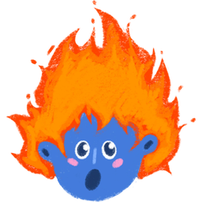
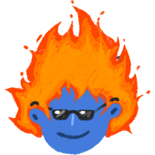
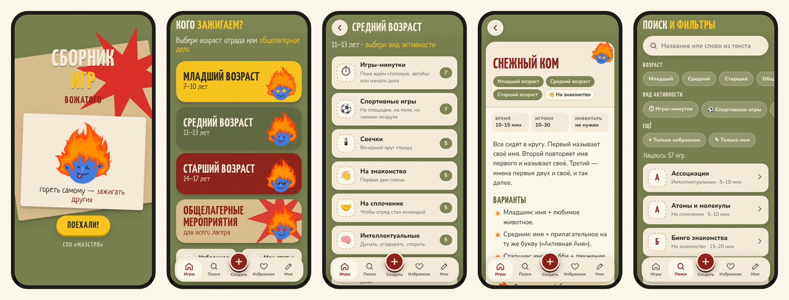
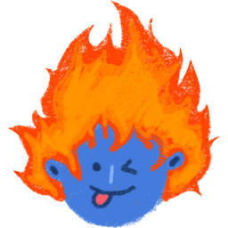

<p align="center">
  
</p>

<h1 align="center">Как поставить «Огонёк» на телефон</h1>

<p align="center"><i>Поставить один раз — играть всю смену, даже без интернета.</i></p>

Инструкция из трёх частей:

- **Часть 1** — быстро посмотреть приложение на телефоне с компьютера (для проверки).
- **Часть 2** — один раз выложить приложение в интернет, чтобы получить постоянную ссылку (делает один человек).
- **Часть 3** — установка на телефон по ссылке (делает каждый вожатый).

---

##  Часть 1. Быстрая проверка с компьютера

Подходит, чтобы показать приложение. Работает, только пока компьютер включён, и телефон должен быть в той же Wi-Fi сети.

1. На компьютере откройте терминал и выполните:
   ```bash
   cd ~/mastro/ogonek
   npm install
   npm run phone:prod
   ```
2. Узнайте IP-адрес компьютера:
   ```bash
   hostname -I
   ```
   Нужен первый адрес, например `172.16.5.29`.
3. На телефоне откройте в браузере `http://172.16.5.29:8090` (подставьте свой адрес).

> В этом режиме приложение **не устанавливается** и **не работает без интернета**: браузер разрешает это только для сайтов по HTTPS. Для настоящей установки переходите к части 2.

**Если не открывается:**
- Проверьте, что телефон и компьютер подключены к одной Wi-Fi сети.
- Выключите VPN на компьютере.
- Проверьте, что в терминале не было ошибок и команда всё ещё работает (окно не закрыто).

---

##  Часть 2. Получить постоянную ссылку (один раз)

Приложение нужно выложить на сайт с HTTPS. Это бесплатно.

### Способ А: Netlify Drop (без регистрации, 2 минуты)

1. Соберите приложение:
   ```bash
   cd ~/mastro/ogonek
   npm install
   npx ng build
   ```
   Появится папка `~/mastro/ogonek/dist/ogonek/browser`.
2. Откройте в браузере на компьютере https://app.netlify.com/drop.
3. Перетащите папку **`browser`** в окно сайта.
4. Через несколько секунд появится ссылка вида `https://что-то-случайное.netlify.app`. Это адрес приложения.

> Без регистрации ссылка живёт около часа. Чтобы она работала всегда, зарегистрируйтесь на Netlify (можно войти через GitHub) и нажмите «Claim site». Там же можно поменять адрес, например на `ogonek-maestro.netlify.app`.

### Способ Б: GitHub Pages (ссылка на основе репозитория)

1. Соберите приложение:
   ```bash
   cd ~/mastro/ogonek
   npx ng build
   ```
2. Выложите сборку в отдельную ветку `gh-pages`:
   ```bash
   cd ~/mastro/ogonek
   npx angular-cli-ghpages --dir=dist/ogonek/browser --no-silent
   ```
3. На GitHub откройте репозиторий → **Settings** → **Pages**.
   В **Source** выберите «Deploy from a branch», ветку **`gh-pages`**, папку **`/ (root)`** и нажмите **Save**.
4. Через 1–2 минуты приложение откроется по адресу:
   `https://chipichapus-chipi-chapa.github.io/Ogonek-A-Collection-of-Games-for-Camp-Counselors/`

**Как обновить приложение:** повторите шаги 1–2 (сборка и выкладка). У вожатых обновление подтянется само, когда телефон будет в интернете.

---

##  Часть 3. Установка на телефон (для вожатых)

Перешлите вожатым ссылку из части 2. Устанавливать нужно **один раз, при интернете**.

### Android (Chrome)

1. Откройте ссылку в **Chrome**.
2. Дождитесь, пока появится заставка с Огоньком.
3. Нажмите меню **⋮** (три точки справа вверху).
4. Выберите **«Установить приложение»** (или **«Добавить на главный экран»**) и подтвердите.
5. На рабочем столе появится иконка **Огонёк**.

> Яндекс Браузер и Samsung Internet тоже подходят: ищите в меню пункт «Добавить на главный экран» / «Установить».

### iPhone (Safari)

1. Откройте ссылку именно в **Safari**: в других браузерах на iPhone установка не работает.
2. Нажмите кнопку **«Поделиться»** (квадрат со стрелкой вверх внизу экрана).
3. Пролистайте вниз и выберите **«На экран „Домой“»**.
4. Нажмите **«Добавить»**.
5. На рабочем столе появится иконка **Огонёк**.

### Проверьте, что всё работает без интернета

1. После установки один раз откройте приложение с иконки и полистайте пару разделов.
2. Включите режим полёта.
3. Закройте приложение и откройте его снова: все игры на месте.

---

##  Как пользоваться

<p align="center"></p>

- **Поехали!** на заставке → выберите возраст или «Общелагерные мероприятия».
- Возраст → **вид активности** (игры-минутки, спортивные, свечки…) → **игра**.
- **♡ В избранное** — игра появится во вкладке «Избранное».
- **＋ Создать** (красная кнопка внизу) — своя статья. Прямо в форме можно добавить **свой фильтр** (вид активности).
- **Мои** — «Моя копилка» с вкладками: свои **статьи**, свои **фильтры** (здесь их тоже можно создавать и удалять) и резервная **копия**.
- **Поиск** — по названию и тексту, с фильтрами по возрасту и виду активности.
- Кнопка **«назад»** на телефоне возвращает на предыдущий экран.

### Важно про свои статьи

Свои статьи, фильтры и избранное хранятся **только на этом телефоне**. Чтобы не потерять их или передать другому вожатому:

- **«Мои» → вкладка «Копия» → «Сохранить в файл»** — скачается файл с вашими статьями и фильтрами;
- на другом телефоне: **«Мои» → «Копия» → «Загрузить из файла»** и выберите этот файл (например, из Telegram или с Диска). Фильтры с одинаковым названием объединятся, дублей не будет.

Если удалить приложение или очистить данные браузера, свои статьи пропадут. Сохраняйте файл время от времени.

---

##  Частые вопросы

**Нет пункта «Установить приложение».**
Откройте ссылку именно в Chrome (на Android) или Safari (на iPhone), дождитесь полной загрузки и обновите страницу. Ссылка должна начинаться с `https://`.

**Открывается старая версия.**
Откройте приложение при интернете, закройте и откройте ещё раз: обновление подтягивается в фоне.

**Пропали мои статьи.**
Скорее всего, очистили данные браузера или переустановили приложение. Восстановить их можно только из файла резервной копии («Мои» → «Копия» → «Загрузить из файла»).

---

<p align="center">
  <br>
  <i>СПО «Маэстро» · гореть самому — зажигать других</i>
</p>
