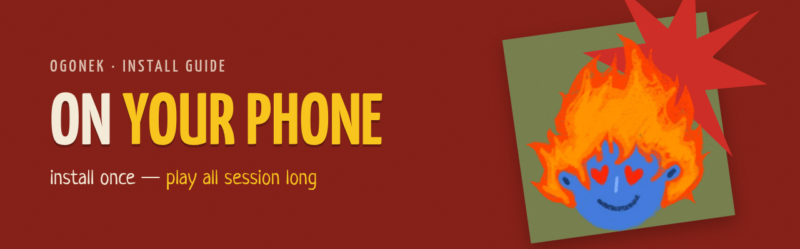

<p align="center">
  
</p>

<h1 align="center">How to Install Ogonek on a Phone</h1>

<p align="center"><i>Install once — play all session long, even without internet.</i></p>

> The app interface is in Russian. Button names are given here in English with the original Russian label in quotes, so you can find them on screen.

This guide has three parts:

- **Part 1** — quickly open the app on a phone from your computer (for testing).
- **Part 2** — publish the app once to get a permanent link (done by one person).
- **Part 3** — install the app on a phone from that link (done by every counselor).

---

##  Part 1. Quick test from your computer

Good for showing the app. It works only while the computer is on, and the phone must be on the same Wi-Fi network.

1. On the computer, open a terminal and run:
   ```bash
   cd ~/mastro/ogonek
   npm install
   npm run phone:prod
   ```
2. Find the computer's IP address:
   ```bash
   hostname -I
   ```
   You need the first address, for example `172.16.5.29`.
3. On the phone, open `http://172.16.5.29:8090` in the browser (use your own address).

> In this mode the app **cannot be installed** and **does not work offline**: browsers allow that only for HTTPS sites. For a real installation, go to Part 2.

**If it does not open:**
- Make sure the phone and the computer are on the same Wi-Fi network.
- Turn off the VPN on the computer.
- Check that the terminal shows no errors and the command is still running (the window is not closed).

---

##  Part 2. Get a permanent link (once)

The app must be published on an HTTPS site. This is free.

### Option A: Netlify Drop (no sign-up, 2 minutes)

1. Build the app:
   ```bash
   cd ~/mastro/ogonek
   npm install
   npx ng build
   ```
   This creates the folder `~/mastro/ogonek/dist/ogonek/browser`.
2. On the computer, open https://app.netlify.com/drop in a browser.
3. Drag the **`browser`** folder into the page.
4. In a few seconds you get a link like `https://something-random.netlify.app`. That is the app's address.

> Without an account the link lasts about an hour. To keep it forever, sign up for Netlify (you can log in with GitHub) and click "Claim site". There you can also change the address, for example to `ogonek-maestro.netlify.app`.

### Option B: GitHub Pages (a link based on this repository)

1. Build the app:
   ```bash
   cd ~/mastro/ogonek
   npx ng build
   ```
2. Publish the build to a separate `gh-pages` branch:
   ```bash
   cd ~/mastro/ogonek
   npx angular-cli-ghpages --dir=dist/ogonek/browser --no-silent
   ```
3. On GitHub, open the repository → **Settings** → **Pages**.
   Under **Source** choose "Deploy from a branch", branch **`gh-pages`**, folder **`/ (root)`**, and click **Save**.
4. After 1–2 minutes the app opens at:
   `https://chipichapus-chipi-chapa.github.io/Ogonek-A-Collection-of-Games-for-Camp-Counselors/`

**To update the app:** repeat steps 1–2 (build and publish). Counselors' phones pick up the update automatically when they are online.

---

##  Part 3. Install on a phone (for counselors)

Send counselors the link from Part 2. Installation is needed **once, with internet**.

### Android (Chrome)

1. Open the link in **Chrome**.
2. Wait for the splash screen with Ogonek.
3. Tap the **⋮** menu (three dots, top right).
4. Choose **Install app** (or **Add to Home screen**) and confirm.
5. The **Огонёк** icon appears on the home screen.

> Yandex Browser and Samsung Internet work too: look for "Add to Home screen" / "Install" in the menu.

### iPhone (Safari)

1. Open the link in **Safari**: installation does not work in other browsers on iPhone.
2. Tap **Share** (the square with an arrow pointing up, at the bottom of the screen).
3. Scroll down and choose **Add to Home Screen**.
4. Tap **Add**.
5. The **Огонёк** icon appears on the home screen.

### Check that it works offline

1. After installing, open the app from the icon once and browse a couple of sections.
2. Turn on airplane mode.
3. Close the app and open it again: all games are still there.

---

##  How to use it

<p align="center"></p>

- **Let's go!** («Поехали!») on the splash screen → choose an age group or camp-wide events («Общелагерные мероприятия»).
- Age group → **activity type** (minute games, sports, evening circles…) → **game**.
- **Add to favorites** («♡ В избранное») — the game appears in the Favorites tab («Избранное»).
- **＋ Create** («Создать», the red button at the bottom) — add your own game. You can add **your own filter** (activity type) right in the form.
- **My** («Мои») — "My collection" («Моя копилка») with tabs: your **games** («Игры»), your **filters** («Фильтры», you can create and delete them here too) and **backup** («Копия»).
- **Search** («Поиск») — by title and text, with filters by age group and activity type.
- The phone's **back** button returns to the previous screen.

### Important: your own games

Your games, filters and favorites are stored **only on this phone**. To keep them safe or share them with another counselor:

- **My** («Мои») → **Backup** tab («Копия») → **Save to file** («Сохранить в файл») — downloads a file with your games and filters;
- on the other phone: **My** («Мои») → **Backup** («Копия») → **Load from file** («Загрузить из файла») and pick that file (for example, from Telegram or a cloud drive). Filters with the same name are merged, no duplicates.

If you delete the app or clear the browser data, your games are lost. Save the file from time to time.

---

##  FAQ

**There is no "Install app" option.**
Open the link in Chrome (Android) or Safari (iPhone), wait for it to load fully, and refresh the page. The link must start with `https://`.

**An old version opens.**
Open the app while online, close it and open it again: updates are downloaded in the background.

**My games disappeared.**
Most likely the browser data was cleared or the app was reinstalled. They can only be restored from a backup file (**My** → **Backup** → **Load from file**).

---

<p align="center">
  <br>
  <i>SPO «Maestro» · burn yourself — light up others</i>
</p>
