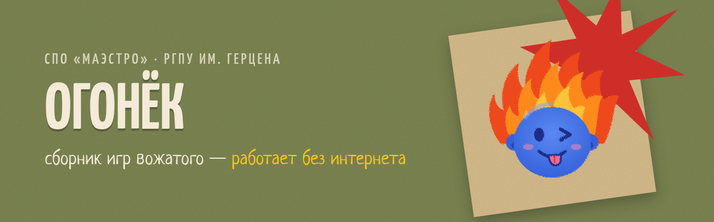
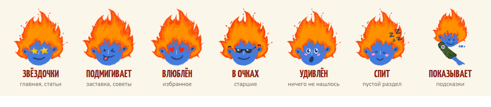
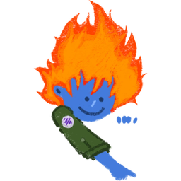
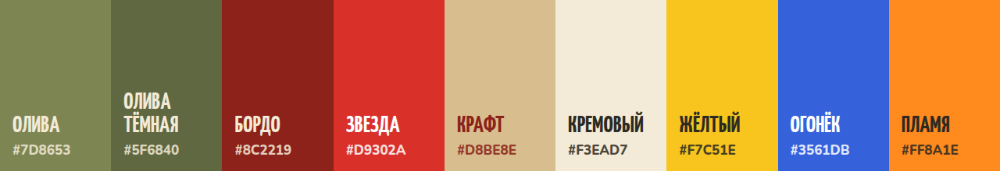
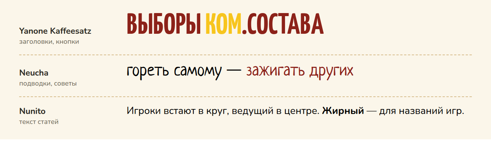

<p align="center">
  
</p>

<h1 align="center">Ogonek — A Collection of Games for Camp Counselors</h1>

<p align="center">
  <b>Огонёк — сборник игр вожатого.</b><br>
  Мобильное приложение, сделанное по заказу студенческого педагогического отряда <b>СПО «Маэстро»</b> РГПУ им. А. И. Герцена.
</p>

<p align="center">
  
  
  
  
</p>

<p align="center">
  
</p>

---

##  Суть проекта

Вожатому в лагере постоянно нужна подходящая игра: пока отряд ждёт столовую, на вечерней свечке, на спортивной площадке, на общелагерном деле. Обычно такие игры хранятся в тетрадках, распечатках и чатах.

**«Огонёк» собирает их в одном месте, в телефоне, и работает без интернета**: в лагере связь часто плохая.

| Что умеет | Как это выглядит |
|---|---|
| 🎯 **Подбор по возрасту** | младший (7–10 лет), средний (11–13), старший (14–17) и общелагерные мероприятия |
| 🗂 **Подбор по виду активности** | игры-минутки, спортивные, свечки, на знакомство, на сплочение, интеллектуальные, творческие |
| ♥ **Своя копилка** | избранное, свои игры и свои виды активностей (фильтры) |
| 📤 **Обмен** | свои игры сохраняются в файл и передаются другому вожатому |
| 📴 **Офлайн** | после первого открытия всё работает в режиме полёта |
| ↩️ **Как обычное приложение** | иконка на рабочем столе, системная кнопка «назад» возвращает на предыдущий экран |

### Как устроена навигация

1. **Заставка** с Огоньком → «Поехали!»
2. **Главное меню**: младший, средний, старший возраст, общелагерные мероприятия
3. **Возраст → вид активности** (игры-минутки, спортивные, свечки…) **→ список игр → текст игры**
4. **Общелагерные** — сразу список мероприятий → текст

---

##  Стилистика

Фирменный стиль взят с постов отряда «Выборы ком.состава 2026–2027»: бумажный коллаж, зернистый фон, повёрнутый лист крафта, красная звезда-взрыв и фото в кремовой рамке. Структура экранов — крупные скруглённые карточки и кнопки-«таблетки».

### Маскот — Огонёк

Синяя мордашка с волосами-пламенем — вожатский дух: **«гореть самому — зажигать других»**. Нарисован от руки мелками, как на постах ком.состава. У Огонька семь эмоций, и каждая отвечает за свою ситуацию в приложении:

<p align="center"></p>

| | Эмоция | Где появляется |
|:---:|---|---|
|  | Звёздочки | главная, младшие, страница игры |
|  | Подмигивает | заставка, советы вожатому |
|  | Влюблён | избранное, общелагерные |
|  | В очках | старший возраст |
|  | Удивлён | ничего не нашлось |
|  | Спит | пустой раздел |
|  | Показывает | пустая «Моя копилка»: подсказка, что делать |

Рисунки: [`docs/mascot/`](docs/mascot/).

### Цвета

<p align="center"></p>

| Цвет | HEX | Где используется |
|---|---|---|
| Олива | `#7D8653` | основной фон, младшие и средние |
| Олива тёмная | `#5F6840` | акцентные карточки, подзаголовки |
| Бордо | `#8C2219` | второй фон, главные кнопки, старшие |
| Красная звезда | `#D9302A` | звезда-взрыв |
| Крафт | `#D8BE8E` | бумага-подложка, рамки |
| Кремовый | `#F3EAD7` | карточки, текст на тёмном |
| Жёлтый акцент | `#F7C51E` | одно-два ключевых слова в заголовке, активные фильтры |
| Синий Огонька | `#3561DB` | только маскот |
| Пламя | `#FF8A1E` | маркеры списков, детали |

### Шрифты

<p align="center"></p>

Все три шрифта с кириллицей и вшиты в приложение, поэтому работают офлайн.

- **Yanone Kaffeesatz** — заголовки и кнопки, всегда капсом: плакатный характер постов.
- **Neucha** — рукописные подводки и советы вожатому (вместо цитат из песен на постах).
- **Nunito** — текст игр и интерфейс.

### Голос

Говорим как старший товарищ-вожатый: на «ты», коротко, с огоньком, без канцелярита.

| ✅ Так | ❌ Не так |
|---|---|
| «Кого зажигаем?» | «Выберите возрастную категорию» |
| «Здесь пока пусто. Добавь свою игру — Огонёк проснётся!» | «Данные отсутствуют» |

Полный брендбук: [`brandbook.html`](brandbook.html). Его нужно открыть в браузере через локальный сервер, см. «Быстрый старт».

---

##  Установка на телефон

Пошаговая инструкция для вожатых и для того, кто выкладывает приложение: **[INSTALL.md](INSTALL.md)**.

##  Что в репозитории

| Папка / файл | Что это |
|---|---|
| [`ogonek/`](ogonek/) | **Основное приложение** на Angular 19, подробнее в [ogonek/README.md](ogonek/README.md) |
| [`brandbook.html`](brandbook.html) | Брендбук: маскот, цвета, шрифты, графические элементы, интерфейс, голос бренда |
| [`docs/`](docs/) | Картинки для README и Огонёк в SVG |
| [`app/`](app/) | Первая версия на чистом HTML/JS (прототип). Брендбук берёт из неё шрифты, Огонька и живые экраны |

##  Быстрый старт

```bash
cd ogonek
npm install
npm start
```

Откроется http://localhost:4200. Чтобы открыть приложение на телефоне в той же Wi-Fi сети:

```bash
cd ogonek
npm run phone:prod
```

Потом на телефоне откройте `http://<IP-компьютера>:8090`.

Брендбук: запустите `python3 -m http.server 8765` в корне репозитория и откройте http://localhost:8765/brandbook.html.

---

<p align="center">
  <br>
  <i>Сделано для СПО «Маэстро» · гореть самому — зажигать других</i>
</p>
