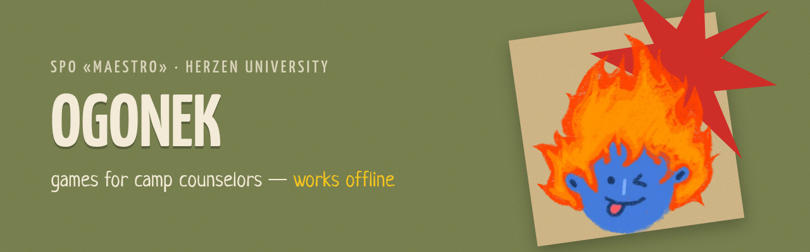
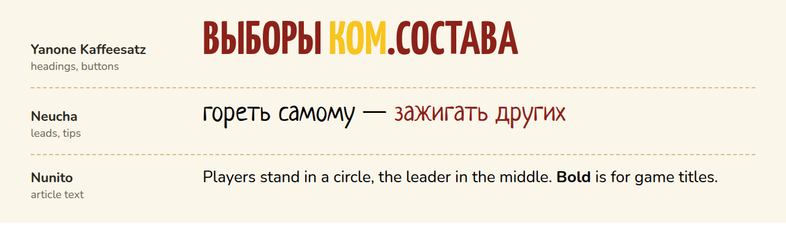

<p align="center">
  
</p>

<h1 align="center">Ogonek — A Collection of Games for Camp Counselors</h1>

<p align="center">
  <b>Ogonek (Огонёк, "little flame") — a game collection for camp counselors.</b><br>
  A mobile app made to order for the student teaching squad <b>SPO «Maestro»</b> of Herzen State Pedagogical University (Saint Petersburg).
</p>

<p align="center">
  
  
  
  
</p>

<p align="center">
  
</p>

> The app interface and the built-in game texts are in Russian; this branch contains the documentation in English.

---

##  What it is

A camp counselor constantly needs the right game: while the group waits for the dining hall, at the evening circle, on the sports ground, at a camp-wide event. Usually these games live in notebooks, printouts and chats.

**Ogonek gathers them in one place, on the phone, and works offline**: connectivity at camps is often poor.

| Feature | What it means |
|---|---|
| 🎯 **Filter by age** | junior (7–10 years), middle (11–13), senior (14–17) and camp-wide events |
| 🗂 **Filter by activity type** | minute games, sports games, evening circles, icebreakers, team building, brain games, creative games |
| ♥ **Personal collection** | favorites, your own games and your own activity types (filters) |
| 📤 **Sharing** | your games are saved to a file and passed to another counselor |
| 📴 **Offline** | after the first launch everything works in airplane mode |
| ↩️ **Feels like a native app** | home screen icon; the system back button returns to the previous screen |

### Navigation

1. **Splash screen** with Ogonek → "Let's go!"
2. **Main menu**: junior, middle, senior age groups, camp-wide events
3. **Age group → activity type** (minute games, sports, evening circles…) **→ game list → game text**
4. **Camp-wide events** — straight to the list of events → text

---

##  Visual style

The brand style comes from the squad's "Commanding staff elections 2026–2027" posts: a paper collage, grainy background, a tilted sheet of kraft paper, a red starburst and photos in cream frames. The screen layout uses large rounded cards and pill-shaped buttons.

### Mascot — Ogonek

A blue face with flaming hair — the counselor spirit: **"burn yourself — light up others"**. Hand-drawn in crayon, like the squad's posts. Ogonek has seven moods, each used in its own situation in the app:

<p align="center"></p>

| | Mood | Where it appears |
|:---:|---|---|
|  | Star eyes | home, junior group, game page |
|  | Wink | splash screen, counselor tips |
|  | In love | favorites, camp-wide events |
|  | Cool | senior age group |
|  | Surprised | nothing found |
|  | Sleepy | empty section |
|  | Pointing | empty "My collection": a hint on what to do |

Drawings: [`docs/mascot/`](docs/mascot/).

### Colors

<p align="center"></p>

| Color | HEX | Used for |
|---|---|---|
| Olive | `#7D8653` | main background, junior and middle groups |
| Dark olive | `#5F6840` | accent cards, subheadings |
| Burgundy | `#8C2219` | second background, primary buttons, senior group |
| Star red | `#D9302A` | the starburst |
| Kraft | `#D8BE8E` | paper backing, frames |
| Cream | `#F3EAD7` | cards, text on dark backgrounds |
| Yellow accent | `#F7C51E` | one or two key words in a heading, active filters |
| Ogonek blue | `#3561DB` | mascot only |
| Flame | `#FF8A1E` | list bullets, details |

### Fonts

<p align="center"></p>

All three fonts support Cyrillic and are bundled into the app, so they work offline.

- **Yanone Kaffeesatz** — headings and buttons, always in caps: the poster feel of the squad's posts.
- **Neucha** — handwritten leads and counselor tips (in place of the song quotes on the posts).
- **Nunito** — game text and interface.

### Voice

We talk like an older fellow counselor: informal, short, with a spark, no bureaucratese.

| ✅ Do | ❌ Don't |
|---|---|
| "Who are we lighting up today?" | "Select an age category" |
| "Nothing here yet. Add your own game — Ogonek will wake up!" | "No data available" |

Full brand book (in Russian): [`brandbook.html`](brandbook.html). Open it in a browser through a local server, see "Quick start".

---

##  Install on a phone

Step-by-step guide for counselors and for whoever publishes the app: **[INSTALL.md](INSTALL.md)**.

##  Repository contents

| Folder / file | What it is |
|---|---|
| [`ogonek/`](ogonek/) | **The main app**, Angular 19, see [ogonek/README.md](ogonek/README.md) |
| [`brandbook.html`](brandbook.html) | Brand book: mascot, colors, fonts, graphic elements, interface, voice |
| [`docs/`](docs/) | Images for the READMEs and Ogonek drawings (`docs/en/` — English versions) |
| [`app/`](app/) | First version in plain HTML/JS (prototype). The brand book takes fonts, Ogonek and live screens from it |

##  Quick start

```bash
cd ogonek
npm install
npm start
```

This opens http://localhost:4200. To open the app on a phone on the same Wi-Fi network:

```bash
cd ogonek
npm run phone:prod
```

Then open `http://<computer-IP>:8090` on the phone.

Brand book: run `python3 -m http.server 8765` in the repository root and open http://localhost:8765/brandbook.html.

---

<p align="center">
  <br>
  <i>Made for SPO «Maestro» · burn yourself — light up others</i>
</p>
