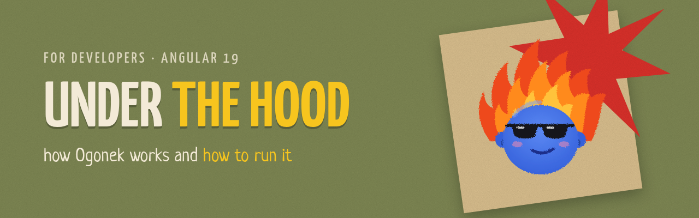
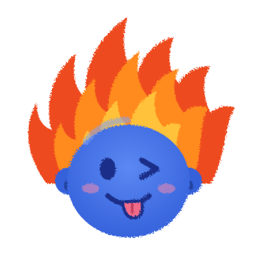
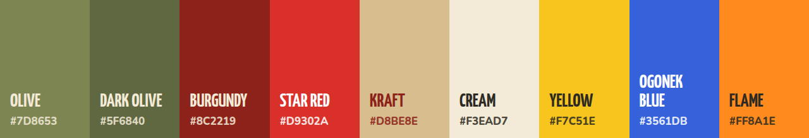
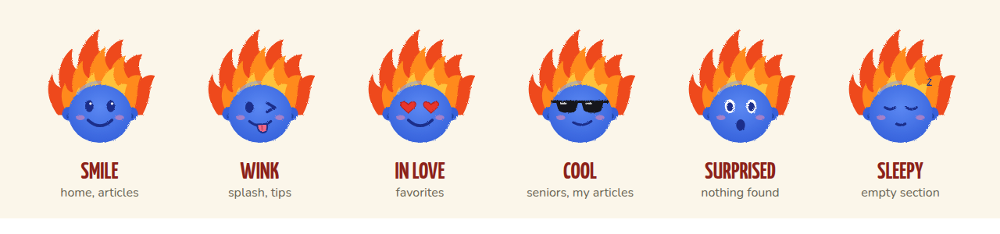
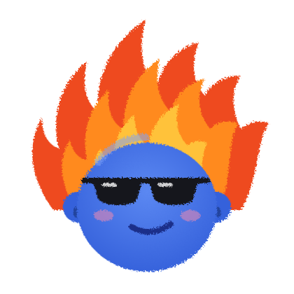
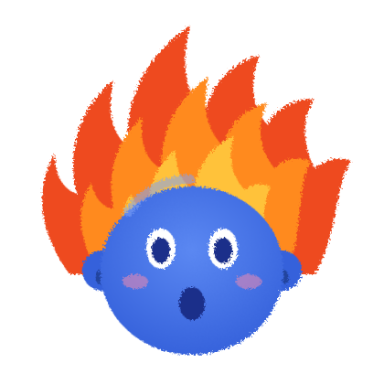
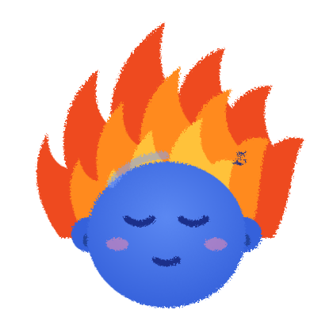

<p align="center">
  
</p>

<h1 align="center">Ogonek — A Collection of Games for Camp Counselors</h1>

<p align="center">
  <b>Ogonek (Огонёк, "little flame") — a game collection for camp counselors.</b> A mobile app made for the student teaching squad (SPO) «Maestro» of Herzen State Pedagogical University.<br>
  This folder contains the Angular 19 source code. Project overview and brand book are in the <a href="../README.md">main README</a>.
</p>

<p align="center"></p>

##  What it is

A camp counselor constantly needs the right game: while the group waits for the dining hall, at the evening circle, on the sports ground, at a camp-wide event. Usually these games live in notebooks, printouts and chats. Ogonek gathers them in one place, on the phone, and works **offline**: connectivity at camps is often poor.

- **Filter by age:** junior (7–10 years), middle (11–13), senior (14–17) and camp-wide events.
- **Filter by activity type:** minute games, sports games, evening circles («свечки»), icebreakers, team building, brain games, creative games.
- **Personal collection:** counselors mark favorites, write their own articles and create their own activity types (filters).
- **Sharing:** your articles can be saved to a file and passed to another counselor.
- **Squad brand style:** olive, burgundy, kraft paper and the mascot Ogonek — a blue face with flaming hair ("burn yourself — light up others").

Technically it is a PWA built with Angular 19: it installs on the phone's home screen, and the system back button returns to the previous screen.

> The app interface and the built-in game texts are in Russian.

##  Style in code

<p align="center"></p>

Colors and fonts are CSS variables in `src/styles.scss`:

```scss
:root {
  --olive: #7D8653;  --olive-dark: #5F6840;  --red: #8C2219;  --red-bright: #D9302A;
  --kraft: #D8BE8E;  --cream: #F3EAD7;       --paper: #FBF6EA; --yellow: #F7C51E;
  --ink: #2C2A22;    --blue: #3561DB;        --orange: #FF8A1E;

  --f-head: 'Yanone Kaffeesatz';  // headings, buttons — all caps
  --f-body: 'Nunito';             // body text
  --f-hand: 'Neucha';             // leads and tips
}
```

Ogonek is the `<og-ogonek mood="wink" [size]="96" />` component (`src/app/ui.ts`). The drawing itself is built as SVG in `src/app/mascot.ts`.

<p align="center"></p>

| `mood` | | Where it is used |
|---|:---:|---|
| `smile` |  | home, articles |
| `wink` |  | splash screen, counselor tips |
| `love` |  | favorites, camp-wide events |
| `cool` |  | senior age group, "My articles" |
| `wow` |  | nothing found, error |
| `sleepy` |  | empty section |

##  Structure

```
src/app/
  app.routes.ts        routes (#/home, #/age/:ageId, #/age/:ageId/:typeId, #/game/:id, #/search, #/fav, #/my, #/new, #/edit/:id)
  app.component.ts     shell: screen + bottom tab bar + toast
  store.service.ts     data: built-in collection + own articles/filters/favorites (signals + localStorage)
  seed.ts              built-in game collection — add "official" games here
  mascot.ts            Ogonek as SVG (6 moods)
  ui.ts                shared components: <og-ogonek>, <og-top>, <og-game-item>, <og-rich-text>
  pages/               screens: splash, home, age, games, game, search, fav, my, form
src/styles.scss        styles and brand colors (:root)
src/fonts/             fonts (bundled into the build)
public/                icons, manifest, Ogonek SVGs
ngsw-config.json       offline cache (Angular Service Worker)
```

##  Run

```bash
npm install
npm start                # development on your computer: http://localhost:4200
```

##  Open on a phone

The phone and the computer must be on the same Wi-Fi network.

```bash
npm run phone:prod       # build + server at http://<computer-IP>:8090
```

Open `http://<computer-IP>:8090` on the phone (find the IP with `hostname -I`).
For development with live reload there is `npm run phone` (port 4200).

> Over a local address (http) the app opens, but the browser does not enable offline mode or installation: that requires HTTPS.

##  Install on phones permanently

1. `npx ng build` → folder `dist/ogonek/browser`.
2. Publish it on any HTTPS hosting, for example drag it onto https://app.netlify.com/drop.
3. Open the link on the phone:
   - Android: ⋮ menu → "Install app";
   - iPhone: "Share" → "Add to Home Screen".
4. After the first launch everything works offline.

An APK can be generated with https://www.pwabuilder.com from the link in step 2.

Full step-by-step guide: [INSTALL.md](../INSTALL.md).

##  Article text markup

```
## Subheading
- list item
> counselor tip (shown in a box with Ogonek)
**bold**
```

---

<p align="center">
  <br>
  <i>SPO «Maestro» · burn yourself — light up others</i>
</p>
