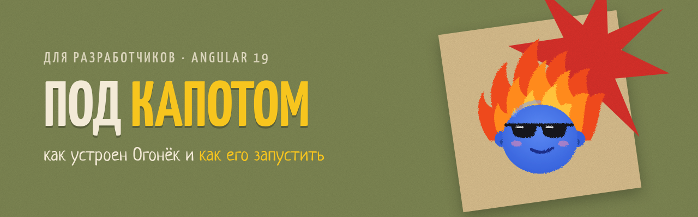

<p align="center">
  
</p>

<h1 align="center">Ogonek — A Collection of Games for Camp Counselors</h1>

<p align="center">
  <b>Огонёк — сборник игр вожатого.</b> Мобильное приложение, сделанное по заказу студенческого педагогического отряда (СПО) «Маэстро» РГПУ им. А. И. Герцена.<br>
  Это папка с исходниками на Angular 19. Обзор проекта и брендбук — в <a href="../README.md">главном README</a>.
</p>

<p align="center"></p>

##  Суть проекта

Вожатому в лагере постоянно нужна подходящая игра: пока отряд ждёт столовую, на вечерней свечке, на спортивной площадке, на общелагерном деле. Обычно такие игры хранятся в тетрадках, распечатках и чатах. «Огонёк» собирает их в одном месте, в телефоне, и работает **без интернета**: в лагере связь часто плохая.

- **Подбор по возрасту:** младший (7–10 лет), средний (11–13), старший (14–17) и общелагерные мероприятия.
- **Подбор по виду активности:** игры-минутки, спортивные, свечки, на знакомство, на сплочение, интеллектуальные, творческие.
- **Своя копилка:** вожатый отмечает игры в избранное, добавляет свои игры и создаёт свои виды активностей (фильтры).
- **Обмен:** свои игры можно сохранить в файл и передать другому вожатому.
- **Фирменный стиль отряда:** олива, бордо, крафт и маскот Огонёк — синяя мордашка с волосами-пламенем («гореть самому — зажигать других»).

Технически это PWA на Angular 19: приложение ставится на главный экран телефона, а системная кнопка «назад» возвращает на предыдущий экран.

##  Стилистика в коде

<p align="center"></p>

Цвета, радиусы и шрифты заданы CSS-переменными в `src/styles/_base.scss`:

```scss
:root {
  --olive: #7D8653;  --olive-dark: #5F6840;  --red: #8C2219;  --red-bright: #D9302A;
  --kraft: #D8BE8E;  --cream: #F3EAD7;       --paper: #FBF6EA; --yellow: #F7C51E;
  --ink: #2C2A22;    --blue: #3561DB;        --orange: #FF8A1E;

  --f-head: 'Yanone Kaffeesatz';  // заголовки, кнопки — капсом
  --f-body: 'Nunito';             // текст
  --f-hand: 'Neucha';             // подводки и советы
}
```

Огонёк — компонент `<og-ogonek mood="wink" [size]="96" />` (`src/app/ui.ts`). Рисунки лежат в `public/img/ogonek/<mood>.webp`: чтобы добавить эмоцию, положите туда файл и допишите имя в тип `Mood` (`src/app/models.ts`).

<p align="center"></p>

| `mood` | | Где используется |
|---|:---:|---|
| `star` |  | главная, страница игры |
| `wink` |  | заставка, советы вожатому |
| `love` |  | избранное, общелагерные |
| `cool` |  | старший возраст |
| `wow` |  | ничего не нашлось, ошибка |
| `sleepy` |  | пустой раздел |
| `point` |  | пустая «Моя копилка»: подсказка, что делать |

##  Структура

```
src/app/
  app.routes.ts        маршруты (#/home, #/age/:ageId, #/age/:ageId/:typeId, #/game/:id, #/search, #/fav, #/my, #/new, #/edit/:id)
  app.component.ts     оболочка: экран + нижнее меню + тост + окно подтверждения
  store.service.ts     данные: встроенная база + свои игры/фильтры/избранное (signals + localStorage)
  seed.ts              встроенная база игр — сюда добавлять «официальные» игры
  models.ts            типы: возраст, вид активности, игра, эмоции Огонька
  ui.ts                единая точка импорта общих компонентов и сервисов
  shared/              по одному файлу на компонент или сервис:
    ogonek.component.ts      <og-ogonek> — Огонёк
    topbar.component.ts      <og-top> — шапка экрана
    game-item.component.ts   <og-game-item> — строка игры в списке
    rich-text.component.ts   <og-rich-text> — текст игры с разметкой
    new-type.component.ts    <og-new-type> — поля «новый фильтр»
    confirm.component.ts     <og-confirm> — окно подтверждения
    confirm.service.ts, toast.service.ts, back.service.ts
  pages/               экраны: splash, home, age, games, game, search, fav, my, form
src/styles.scss        подключает разделы стилей по порядку
src/styles/            _base (цвета бренда), _splash, _home, _lists, _game, _form, _my, _confirm, _animations…
src/fonts/             шрифты (вшиваются в сборку)
public/                иконки, манифест, Огонёк (img/ogonek/*.webp, 7 эмоций)
ngsw-config.json       офлайн-кэш (Angular Service Worker)
```

##  Запуск

```bash
npm install
npm start                # разработка на компьютере: http://localhost:4200
```

##  Открыть на телефоне

Телефон и компьютер должны быть в одной Wi-Fi сети.

```bash
npm run phone:prod       # сборка + сервер на http://<IP-компьютера>:8090
```

Открой на телефоне `http://<IP-компьютера>:8090` (IP смотри командой `hostname -I`).
Для разработки с автообновлением есть `npm run phone` (порт 4200).

> По локальному адресу (http) приложение открывается, но браузер не включает офлайн-режим и установку: для этого нужен HTTPS.

##  Установить на телефоны насовсем

1. `npx ng build` → папка `dist/ogonek/browser`.
2. Выложи её на любой HTTPS-хостинг, например перетащи на https://app.netlify.com/drop.
3. Открой ссылку на телефоне:
   - на Android: меню ⋮ → «Установить приложение»;
   - на iPhone: «Поделиться» → «На экран „Домой“».
4. После первого открытия всё работает без интернета.

APK можно получить через https://www.pwabuilder.com по ссылке из шага 2.

##  Разметка текста игры

```
## Подзаголовок
- пункт списка
> совет вожатому (плашка с Огоньком)
**жирный**
```

---

<p align="center">
  <br>
  <i>СПО «Маэстро» · гореть самому — зажигать других</i>
</p>
